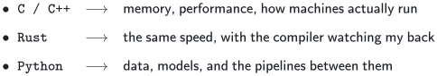

  <picture>
    <source media="(prefers-color-scheme: dark)" srcset="./assets/title-dark.svg">
    <source media="(prefers-color-scheme: light)" srcset="./assets/title-light.svg">
    
  </picture>

  <picture>
    <source media="(prefers-color-scheme: dark)" srcset="./assets/research-dark.svg">
    <source media="(prefers-color-scheme: light)" srcset="./assets/research-light.svg">
    
  </picture>

 

  <picture>
    <source media="(prefers-color-scheme: dark)" srcset="./assets/h-stack-dark.svg">
    <source media="(prefers-color-scheme: light)" srcset="./assets/h-stack-light.svg">
    
  </picture>

  <picture>
    <source media="(prefers-color-scheme: dark)" srcset="./assets/stack-sub-dark.svg">
    <source media="(prefers-color-scheme: light)" srcset="./assets/stack-sub-light.svg">
    
  </picture>

  <picture>
    <source media="(prefers-color-scheme: dark)" srcset="./assets/stack-dark.svg">
    <source media="(prefers-color-scheme: light)" srcset="./assets/stack-light.svg">
    
  </picture>

 

  <picture>
    <source media="(prefers-color-scheme: dark)" srcset="./assets/h-foundations-dark.svg">
    <source media="(prefers-color-scheme: light)" srcset="./assets/h-foundations-light.svg">
    
  </picture>

  <picture>
    <source media="(prefers-color-scheme: dark)" srcset="./assets/skills-dark.svg">
    <source media="(prefers-color-scheme: light)" srcset="./assets/skills-light.svg">
    
  </picture>

<!--
  ⟨stack|SyNikolai⟩        projection onto "stack"       → languages
  ⟨foundations|SyNikolai⟩  projection onto "foundations" → skill tree

  circuit:  H = every interest starts in superposition
            ●──⊕ = one interest feeds another:
                   data engineering → data science → advanced ml → mlops → robotics,
                   quantum computing → advanced ml (quantum machine learning)
  tree:     linear algebra → quantum mechanics → |ψ⟩
            linear algebra + statistics → neural networks → |ψ⟩
            statistics + algorithms → databases / systems architecture → software engineering → |ψ⟩
  all LaTeX is pre-rendered to assets/*.svg (MathJax) so it looks the same on web and mobile
-->
